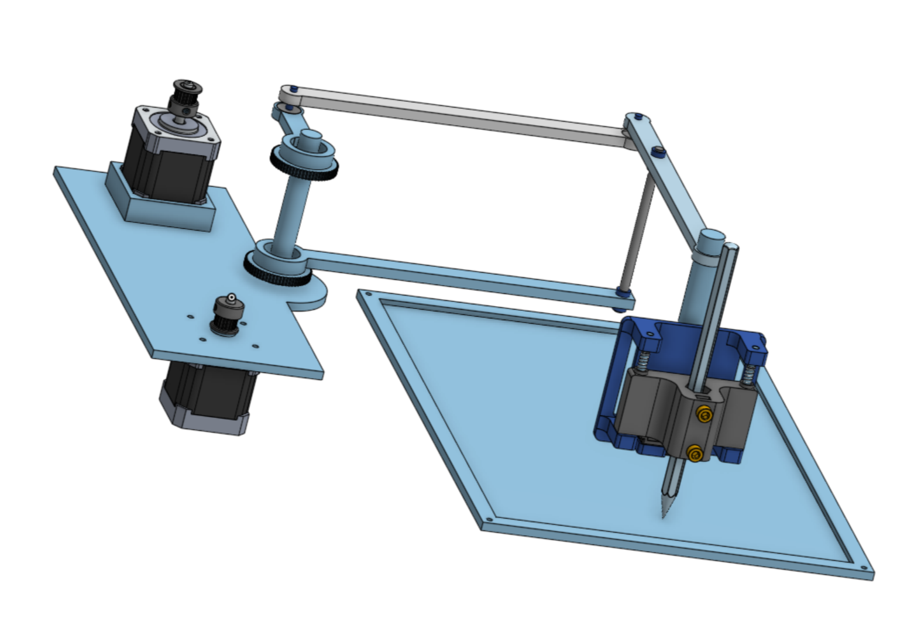
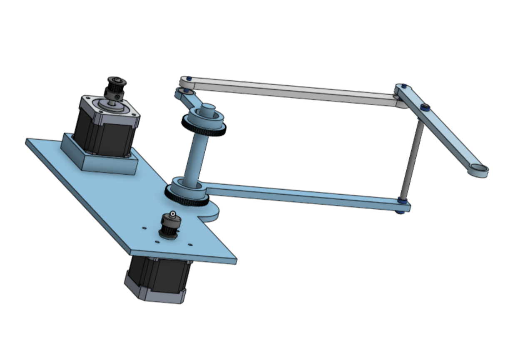
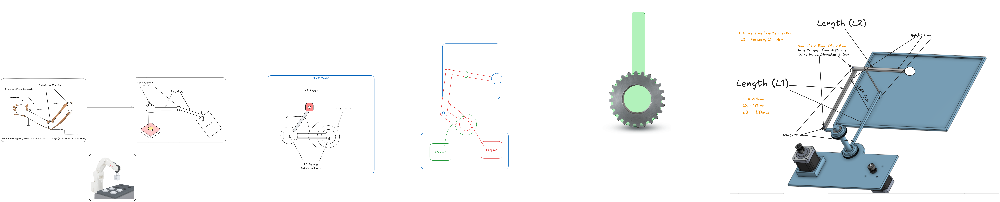

# Scara Robot

A SCARA (Selective Compliance Articulated Robot Arm) designed from scratch in Onshape, driven by two NEMA 17 steppers through GT2 belts, with a swappable end-of-arm tool. There is no default tool: the pen holder and tray in the renders is placeholder that shows the mechanism.

The robot is a two-joint SCARA arm driven by two NEMA 17 steppers mounted on a shared base plate. Each motor has a GT2 pulley that drives a belt to a larger pulley on a concentric shaft, so the two motors control two separate links independently. One link rotates the whole arm about the shoulder, and the other moves the elbow through a parallelogram linkage that keeps the tool at a constant orientation while the arm moves. By coordinating the two motor angles, the tip can be positioned anywhere in the flat work area.

[Project Link to Onshape](https://cad.onshape.com/documents/650ab9a2d45b8996f39b5749/w/bf6e4fe6e729a6972b5b6d5c/e/eb933e9525c3fc6056b566d6?renderMode=0&uiState=6af1412141331449e3bd090b)

Project:

The complete assembly, without the placeholder tray and placeholder arm:

---

## Overview

I started by thinking about how a human arm works, which led me to SCARA robots, so I decided to build one.

Details

Features
- Two-motor SCARA mechanism: two NEMA 17 steppers mounted on a shared base plate, each driving a link through a GT2 pulley and belt
- Parallelogram linkage: the upper links keep the end effector orientation fixed as the arm moves
- Replaceable arm: the arm is designed to be swapped out for different scenarios

---

## Resources

Models imported:
- [Stepper Motor](https://grabcad.com/library/nema-17-stepper-motor-1)
- [GT2 Pulley](https://grabcad.com/library/timing-pulley-gt2-20-teeth-5mm-bore-2)
- [Pen Holder](https://grabcad.com/library/cnc-pen-holder-2)

---

> The project file is contained in the folder `project_files` :)